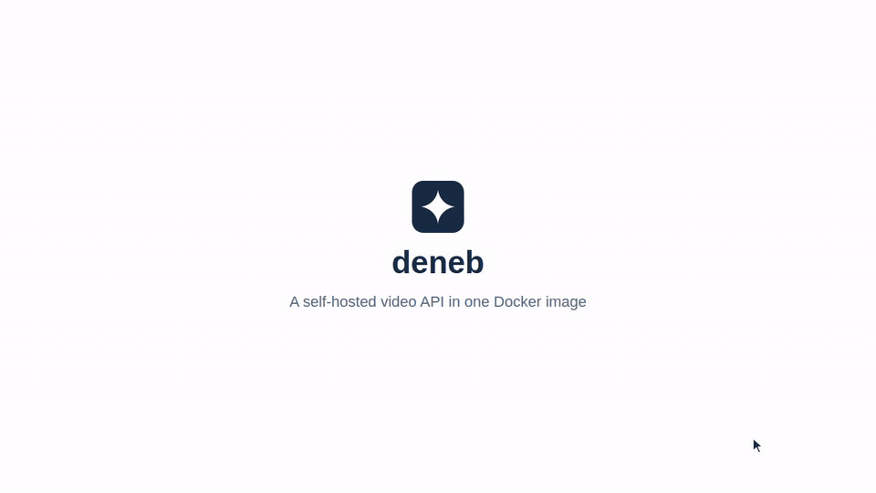

# deneb

deneb is a self-hosted video API that runs as one Docker image, as an alternative to hosted services such as Mux.
You upload a video, and deneb encodes it to HLS in several qualities, writes captions with Whisper, and returns signed URLs to play or embed it.
A typical use is the videos of your own product, such as lessons, demos, or recordings, which you upload once and play in your site or app.



## Contents

- [How it works](#how-it-works)
- [What deneb returns](#what-deneb-returns)
- [Features](#features)
- [Quick start](#quick-start)
- [Documentation](#documentation)
- [License](#license)

## How it works

A video goes through four steps.

1. Your server creates a video through the JSON API, and gets a signed URL for its file.
2. Your server, or the browser of your user, sends the file to that URL in one PUT, or with tus, a protocol for uploads that resume after a lost connection.
3. deneb encodes the video to HLS (HTTP Live Streaming) in the background, and writes its captions. HLS splits a video into short segments in several qualities, and players switch between the qualities to fit the connection.
4. A webhook tells your app that the video is ready. Your app gets its signed playback URLs, and plays it in any HLS player or in the embed page.

deneb is one Go program with SQLite, ffmpeg, and whisper.cpp in one image. It needs no database server, no queue, and no cloud service.

## What deneb returns

deneb takes one video file, and returns the URLs that play it.
Your app gets them from the API, and a webhook tells it when they are ready.

```text
A video file, such as an MP4
  |  your app creates a video, and sends the file in one PUT
  v
deneb encodes the video, and writes its captions
  |
  +-- hls_url         the stream, in up to four qualities from 1080p to 360p
  +-- embed_url       a page with a player, for an iframe on any site
  +-- captions_url    the captions as a WebVTT file, when captions are on
  +-- poster_url      a still to show before the video plays
  +-- storyboard_url  the pictures that the seek bar shows as previews
```

- `hls_url` plays in any HLS player, such as hls.js, Video.js, or the player of Safari, iOS, and Android. `embed_url` needs no player of your own.
- The webhooks are `video.ready`, `video.failed`, and `video.captions_ready`. Your app can publish a video when its `video.ready` arrives.
- The URLs are signed, and expire after 24 hours by default, so a URL that someone copies stops working a day later. The video itself stays, and each answer of the API carries fresh URLs.
- Your app asks deneb for the video when it shows a page, so viewers always get URLs that work.
- A page that pastes an embed code once and has no server, such as a blog post, needs URLs that last longer. `DENEB_PLAYBACK_TTL_HOURS` sets how many hours they last, such as 87600 for ten years.
- The files stay on the volume of deneb, or in an S3-compatible bucket. deneb offers no MP4 downloads of its encodings.

## Features

- Encoding: up to four qualities from 1080p to 360p, in H.264 and AAC, with a poster and a storyboard for previews on the seek bar
- Uploads: one PUT to a signed URL, or tus, which resumes after a lost connection, for files of up to 50 GB
- Captions: whisper.cpp on the CPU of the server, in the spoken language that it detects, so the audio goes to no other service
- Playback: signed URLs that expire, for any HLS player, and an embed page for an iframe on any site
- Webhooks: signed events when a video is ready, when it failed, and when its captions are ready, sent again when a delivery fails
- Dashboard: uploads, plays, renames, and deletes videos, and manages the keys of the API and the webhooks
- Storage: the volume of deneb, or a bucket of Amazon S3, Cloudflare R2, or another S3-compatible service

## Quick start

These commands run deneb on your machine with Docker.

```sh
# Run deneb on port 8080, with its database and videos in a volume named deneb-data.
docker run -d --name deneb -p 8080:8080 -v deneb-data:/data ghcr.io/etak64n/deneb
# Read the setup code that deneb writes to its log until it has an administrator.
docker logs deneb
```

- `-d` runs the container in the background, and `--name deneb` names it for `docker logs`.
- `-p 8080:8080` publishes the port of the dashboard and the API.
- `-v deneb-data:/data` keeps the database, the uploads, and the videos when the container is replaced.

Open http://localhost:8080, and create the administrator with an email, a password, and the setup code of the log.
Then drop a video on the page. The video plays once its state is Ready.

## Documentation

The [documentation site](https://etak64n.github.io/deneb/) describes the latest release.

- [Deploy](https://etak64n.github.io/deneb/getting-started/deploy/): deneb under your own domain, with Docker Compose behind a reverse proxy
- [Upload videos](https://etak64n.github.io/deneb/guides/uploads/): a file in one PUT, with tus, or from the browser of your user
- [Play videos](https://etak64n.github.io/deneb/guides/playback/): the signed URLs of a ready video, and the embed page
- [Webhooks](https://etak64n.github.io/deneb/guides/webhooks/): the events, their retries, and how to verify their signature
- [API reference](https://etak64n.github.io/deneb/reference/api/): every endpoint, and the video object
- [Configuration reference](https://etak64n.github.io/deneb/settings/configuration/): every environment variable and its default

The same pages are the Markdown files in docs/src/content/docs.

## License

deneb is released under the MIT License (LICENSE).

The image also contains software under its own licenses, among them FFmpeg, under GPL-2.0-or-later as Alpine Linux builds it, and whisper.cpp, under MIT.
deneb runs FFmpeg as a separate program. The Whisper models that deneb downloads are under MIT.
