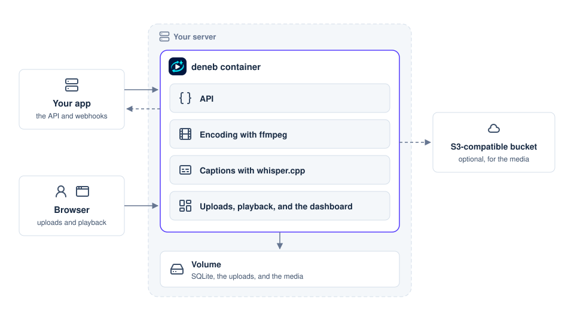

<h1 align="center">
  <picture>
    <source media="(prefers-color-scheme: dark)" srcset=".github/deneb-wordmark-dark.png">
    
  </picture>
</h1>

<p align="center">A self-hosted video API in one Docker image, with HLS encoding and automatic captions.</p>

<p align="center">
  <a href="https://github.com/etak64n/deneb/actions/workflows/ci.yml"></a>
  <a href="https://github.com/etak64n/deneb/actions/workflows/docs.yml"></a>
  <a href="https://github.com/etak64n/deneb/releases"></a>
  <a href="https://github.com/etak64n/deneb/blob/main/LICENSE"></a>
</p>

<p align="center">
  <a href="https://etak64n.github.io/deneb/">Docs</a>
  · <a href="#quickstart">Quickstart</a>
  · <a href="https://github.com/etak64n/deneb/releases">Releases</a>
  · <a href="https://github.com/etak64n/deneb/issues">Issues</a>
</p>


deneb serves the videos of your own product, such as lessons, demos, or recordings, from your own server. Your app creates a video through the API and sends its file in one PUT, or with tus, which resumes after a lost connection. deneb encodes the video to HLS in up to four qualities, writes its captions with whisper.cpp, and tells your app with a signed webhook when it is ready. The video then plays from signed URLs in any HLS player, or in an embed page on any site.

## Architecture



deneb is one Go program with SQLite, ffmpeg, and whisper.cpp in one image, so it needs no database server, no queue, and no cloud service. A ready video has these URLs.

| URL | Role |
| --- | --- |
| **hls_url** | Plays the stream in any HLS player, such as hls.js, Video.js, or the players of Safari, iOS, and Android. |
| **embed_url** | Opens a page with a player, for an iframe on any site. |
| **captions_url** | Holds the captions as a WebVTT file. |
| **poster_url** | Shows a still before the video plays. |
| **storyboard_url** | Gives the seek bar its previews. |

The URLs expire after 24 hours by default, and each answer of the API carries fresh ones. A video with permanent URLs keeps them, for a page that pastes an embed code once, such as a blog post.

## Quickstart

deneb needs only Docker, on amd64 or arm64.

### 1. Run deneb

```sh
# Run deneb on port 8080, with its database and videos in a volume named deneb-data.
docker run -d --name deneb -p 8080:8080 -v deneb-data:/data ghcr.io/etak64n/deneb
```

- `-d` runs the container in the background, and `--name deneb` names it for `docker logs`.
- `-p 8080:8080` publishes the port of the dashboard and the API.
- `-v deneb-data:/data` keeps the database, the uploads, and the videos when the container is replaced.
- `-e DENEB_CAPTIONS=true`, added before the image, turns on captions.

### 2. Create the Administrator

```sh
# Read the setup code that deneb writes to its log until it has an administrator.
docker logs deneb
```

Open http://localhost:8080, and create the administrator with an email, a password, and the setup code.

### 3. Upload a Video

Drop a video on the videos page. It plays once its state is Ready.
To send videos from your app, create a key on the API keys page, and follow [Upload videos](https://etak64n.github.io/deneb/guides/uploads/).

See [Deploy](https://etak64n.github.io/deneb/getting-started/deploy/) to run deneb under your own domain, and [Configuration](https://etak64n.github.io/deneb/settings/configuration/) for every setting.

## Updating and Uninstalling

Before you update, check the [release notes](https://github.com/etak64n/deneb/releases). Then replace the container with the new image. deneb updates its database at start, and the volume keeps the videos.

```sh
# Download the latest image, and replace the container with it
docker pull ghcr.io/etak64n/deneb
docker rm -f deneb
docker run -d --name deneb -p 8080:8080 -v deneb-data:/data ghcr.io/etak64n/deneb
```

With Docker Compose, as in [Deploy](https://etak64n.github.io/deneb/getting-started/deploy/), run `docker compose pull` and `docker compose up -d` instead.

To uninstall, remove the container and its volume. Removing the volume deletes the videos, the keys, and the webhooks. With S3 storage, the media stay in the bucket.

```sh
# Remove the container, then the volume with the database and the videos
docker rm -f deneb
docker volume rm deneb-data
```

## License

deneb is released under the MIT License. The image also contains FFmpeg, under GPL-2.0-or-later as Alpine Linux builds it, and whisper.cpp, under MIT. deneb runs FFmpeg as a separate program, and the Whisper models that it downloads are under MIT.
